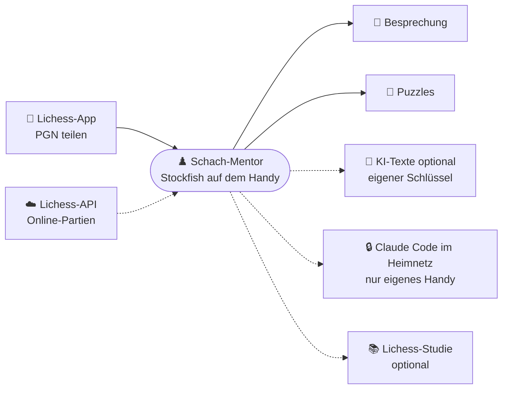
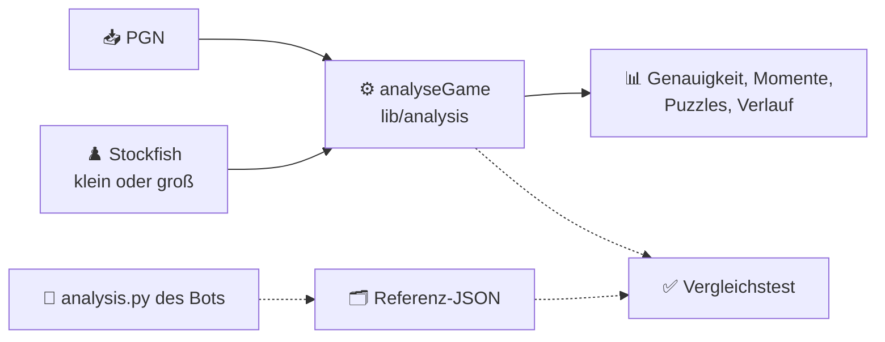
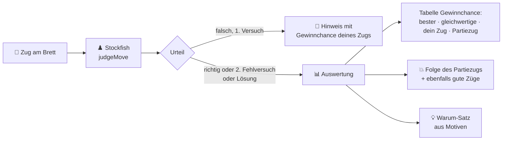

# ♟️ Schach-Mentor (Android-App)

Stockfish rechnet, du lernst: Android-App, die eigene Schachpartien auf dem Handy analysiert, Fehler im Dialog bespricht
und als Puzzles mit Wiederholung einübt. Ohne eigenen Server und ohne Pflicht-Schlüssel. Entstanden aus einem privaten
Telegram-Bot, den die App ab Ende 2026 ersetzt.

> **Stand: Phase 3 (10.11.2026), nächster Schritt 1 der Roadmap.** Partien kommen per Teilen, Einfügen oder Datei in die App. Stockfish analysiert sie auf dem Handy
> wie der Telegram-Bot: Genauigkeit, Fehler-Einstufung, Verlauf und Schlüsselmomente mit Pfeilen und Varianten.
> Dazu kommen die sokratische Besprechung am Brett und Puzzles aus eigenen Fehlern mit Wiederholung und Erinnerung.

## 🧭 Zielbild



Texte entstehen in drei Stufen, nur die erste ist Pflicht:

| Stufe | Wie | Kosten |
|---|---|---|
| Textbausteine | aus Engine-Fakten und Motiven, offline | keine |
| Heimserver | Claude Code auf dem eigenen Server, nur im Heimnetz (geplant) | eigenes Abo |
| Eigener Schlüssel | App fragt den Anbieter des Nutzers direkt (geplant) | je nach Anbieter |

Jeder KI-Text wird gegen die Engine-Fakten geprüft. Nennt er einen Zug, der dort nicht steht, gelten die Textbausteine.

## 🗂️ Aufbau

```
chess-mentor-app/
├── lib/
│   ├── analysis/        Port von analysis.py: Gewinnchance, Einstufung, Momente, Motive (reines Dart, testbar)
│   ├── coach/           Texte des Mentors ohne Sprachmodell: Fragen, Tipps, Erklärungen, Lernpunkt
│   ├── puzzles/         Wiederholungsplan und vorausgeplante Erinnerungen
│   ├── engine/          Stockfish auf dem Handy (kleines/großes Netz), Netz-Download, Analyse-Warteschlange
│   ├── data/            Partien in SQLite, Einstellungen
│   ├── ui/              Partienliste, Import, Partie- und Momentansicht, Gewinnchance-Tabelle, Engine-Seite, Texte DE/EN
│   └── main.dart
├── test/                Unit-Tests und Vergleich mit dem Bot (fixtures: gemeinfreie Partien + Bot-Referenz)
├── android/             Android-Projekt, Speichergrenzen in gradle.properties
├── tools/
│   ├── build-apk.sh     begrenzter APK-Build für den Heimserver
│   └── make_golden.sh   Referenzanalyse mit dem Code des Telegram-Bots erzeugen
└── LICENSE              GPL-3.0
```

## 🔬 Analyse wie der Bot



Der Vergleichstest rechnet dieselben Partien mit derselben Engine wie der Bot (Stockfish im Container `chess-mentor`)
und prüft jedes Feld. Ohne den Container wird er übersprungen.

| Netz | Herkunft | Pixel 6, Tiefe 16, 1 Thread |
|---|---|---|
| klein (`light`) | in der App, ~1 MB | 0,73 s je Stellung |
| groß (`nn-1a298aa575a0`) | Download 98,5 MB, SHA-256-Prüfung | 1,26 s je Stellung |

## 🧩 Puzzle-Auswertung

Nach jedem Puzzle (gelöst oder Lösung gezeigt) erklärt die App, **warum** ein Zug gut oder schlecht war. Alle Zahlen
kommen von Stockfish, die Sätze aus Textbausteinen (`coach_texts.dart`), also ohne Sprachmodell und offline.



Die Gewinnchance-Tabelle (`lib/ui/evaluation_table.dart`) ist ein gemeinsames Bauteil: Puzzle, Besprechung und Partieansicht zeigen dieselbe Tabelle (bester Zug zuerst, Rest nach Gewinnchance sortiert, Differenz aus gerundeten Werten, Züge mit Zugnummer). Die Prozentwerte stehen nur dort, nicht noch einmal im Fließtext. Das Muster stammt vom Telegram-Bot, dort ergänzt Claude die Erklärung. Abstimmung der beiden Projekte:
Brain-Notiz „Schach-Mentor – Bot und App abgleichen“.

## ⚙️ Entwicklung

```bash
flutter pub get
flutter analyze
flutter test
tools/build-apk.sh       # Release-APK: build/app/outputs/flutter-apk/app-release.apk
adb install -r -t build/app/outputs/flutter-apk/app-release.apk   # -t: APK ist derzeit test-only
```

Gebaut wird nur `arm64-v8a` (`android.injected.build.abi` in `android/gradle.properties`).

## ⚠️ Stolpersteine

- `multistockfish` kompiliert drei Engines aus C++. Ohne Grenze hat das den Heimserver lahmgelegt, deshalb dort nie
  `flutter build` direkt aufrufen. `tools/build-apk.sh` baut in einer eigenen cgroup, mit einem Compiler-Job und
  Wächter. Es setzt die Pfade dieses Servers voraus.
- Die Vorlage von Flutter setzt Gradle auf 8 GB Heap, hier sind es 2 GB.
- **Zum Testen immer Release bauen:** Im Debug-Build kompiliert das Stockfish-Plugin ohne Optimierung und rechnet um ein
  Vielfaches langsamer (ca. 25 s statt 0,7 s je Stellung).
- Mehr Threads machen die Analyse bei fester Tiefe nicht schneller (Pixel 6, kleines Netz: 4 Threads 1,28 s, 1 Thread
  0,73 s; großes Netz: 3,35 s gegenüber 1,26 s).
- Bei ausgeschaltetem Bildschirm pausiert Android die Engine; die App hält ihn während einer Analyse wach.
- Die APK ist noch als `testOnly` markiert und braucht `adb install -t`. Vor der Veröffentlichung entfernen.

## 🗺️ Roadmap

- [x] **Phase 0:** Werkzeuge, Prüf-App auf dem Gerät (getestet auf Pixel 6, Android 16)
- [x] **Phase 1:** PGN-Eingang, Analyse (Vergleich mit dem Bot, beide Netze)
- [x] **Phase 2:** Besprechung am Brett (Frage, Zug, Prüfung, Tipp, Auflösung, Lernpunkt)
- [x] **Phase 3:** Puzzles mit Wiederholung (1 · 3 · 7 · 21 · 60 Tage), tägliche Erinnerung ohne Server, Auswertung mit Gewinnchance, Folge und Begründung
- [ ] **Schritt 1:** Aufräumen: App-ID `io.github.adubdubdub.schachmentor`, Signierschlüssel, kein `testOnly`, GitHub Actions
- [ ] **Schritt 2:** Puzzles: Versuche speichern, Aufstieg nur im ersten Versuch ohne Tipp, zweizügige Puzzles
- [ ] **Schritt 3:** KI-Texte: Heimserver (Claude Code) und eigener Schlüssel, mit Zugprüfung
- [ ] **Schritt 4:** Export/Import, Übernahme der Bot-Daten
- [ ] **Schritt 5:** Abruf per Benutzername (Lichess, Chess.com), mehrere Partien je PGN
- [ ] **Schritt 6:** Schwächenprofil und Wochenfokus
- [ ] **Schritt 7:** Erste Weitergabe an Familie und Freunde (GitHub Releases, Obtainium)
- [ ] **Schritt 8:** F-Droid: Übersetzungsdateien, Barrierefreiheit, Datenschutzhinweis

iOS ist zurückgestellt.

## 📜 Lizenz

GPL-3.0, weil Stockfish und die Lichess-Pakete unter dieser Lizenz stehen. Die App steht in keiner Verbindung zu Lichess.
