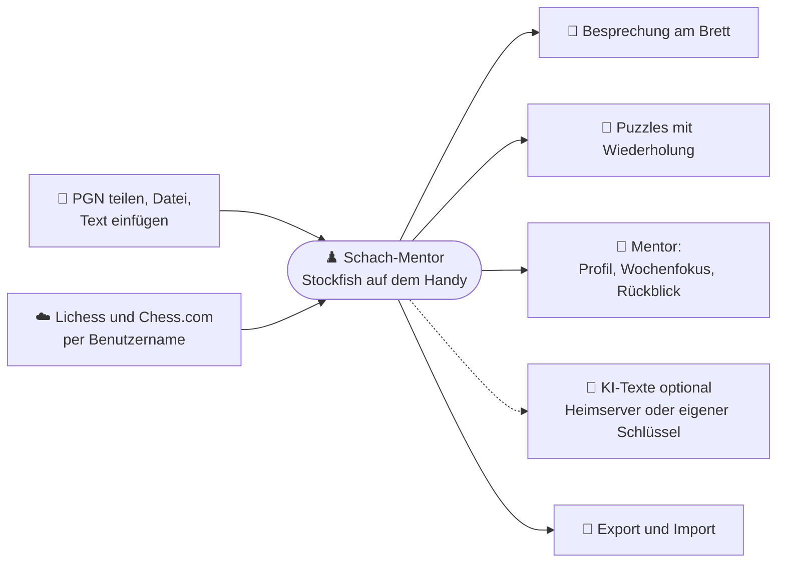
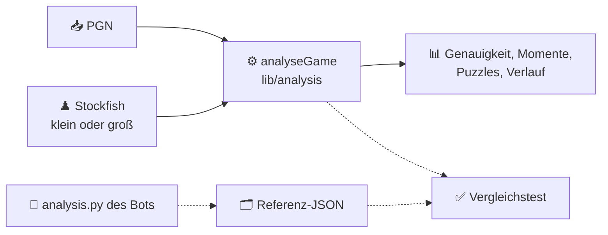
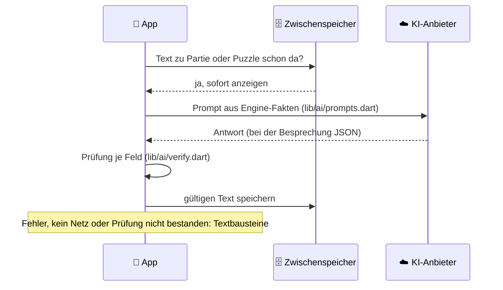
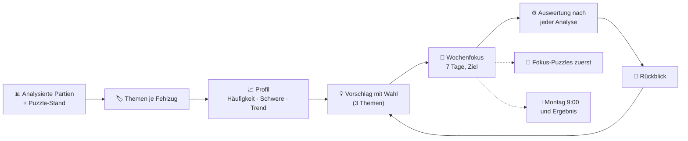
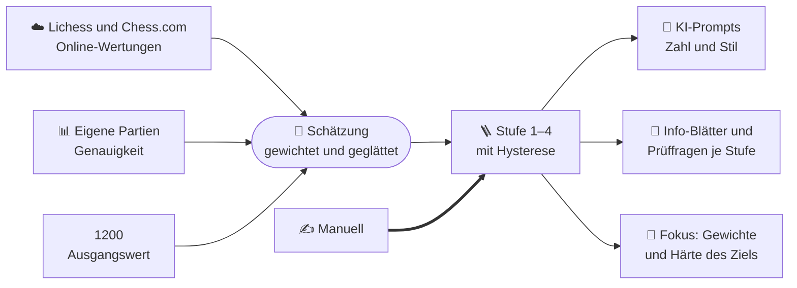
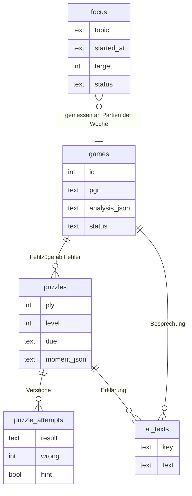
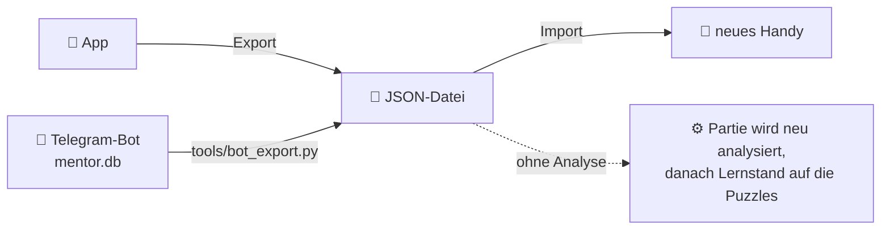
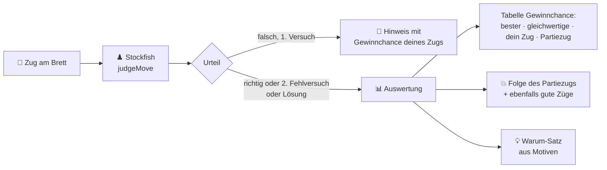

# ♟️ Schach-Mentor (Android-App)

Stockfish rechnet, du lernst: Android-App, die eigene Schachpartien auf dem Handy analysiert, Fehler im Dialog bespricht
und als Puzzles mit Wiederholung einübt. Ohne eigenen Server und ohne Pflicht-Schlüssel. Entstanden aus einem privaten
Telegram-Bot, den die App seit November 2026 ersetzt.

> **Stand (15.11.2026): Schritte 1–6 umgesetzt, Testzeit am Handy läuft.** Die Erklärungen passen sich an die geschätzte
> Spielstärke an (E1–E4 umgesetzt); Schritt 7 (Weitergabe) kommt erst nach der Testzeit.
>
> Partien kommen per Teilen, Einfügen, Datei oder Benutzername von Lichess und Chess.com in die App. Stockfish analysiert sie
> auf dem Handy: Genauigkeit, Fehler-Einstufung, Verlauf und Schlüsselmomente mit Pfeilen und Varianten. Dazu kommen die
> sokratische Besprechung am Brett, Puzzles aus eigenen Fehlern mit Wiederholung und der **Mentor**: Schwächenprofil und
> Wochenfokus mit Ziel, Auswertung und Rückblick. Texte kommen auf Wunsch von einer KI (eigener Heimserver oder eigener
> Schlüssel), immer gegen die Engine-Fakten geprüft und mit „✨ KI“ gekennzeichnet.

## Auf einen Blick
| | |
|---|---|
| **Zweck** | Schach-Analyse und Lerntrainer als Android-App |
| **App-ID** | `io.github.adubdubdub.schachmentor` |
| **Engine** | Stockfish 17.1 auf dem Handy |
| **Build** | nur mit `tools/build-apk.sh`, CI bei jedem Push |
| **Daten** | SQLite auf dem Handy (Schema 5), Export als JSON, kein Server nötig |
| **Tests** | über 100 Unit- und Widget-Tests, dazu Engine-Vergleich mit dem Bot (nur auf dem Heimserver) |
| **Nachfolger von** | Telegram-Bot `chess-mentor` |

> [!CAUTION]
> Der Release-Signierschlüssel (`/root/keys/schachmentor`) wird nie ausgegeben oder committet. Geht er verloren, gibt es keine Updates mehr.

## 🧭 Überblick



Texte entstehen in drei Stufen, nur die erste ist Pflicht:

| Stufe | Wie | Kosten |
|---|---|---|
| Textbausteine | aus Engine-Fakten und Motiven, offline | keine |
| Heimserver | Claude Code auf dem eigenen Server über ein KI-Gateway (OpenAI-kompatibel), nur für das eigene Handy | eigenes Abo |
| Eigener Schlüssel | App fragt den Anbieter des Nutzers direkt (OpenAI-kompatibel: OpenRouter, Gemini, Ollama, OpenAI) | je nach Anbieter |

Jeder KI-Text wird gegen die Engine-Fakten geprüft. Nennt er einen Zug, der dort nicht steht, gelten die Textbausteine.
Mehr dazu im Abschnitt [KI-Texte](#-ki-texte).

## 🗂️ Aufbau

```
chess-mentor-app/
├── lib/
│   ├── analysis/        Port von analysis.py: Gewinnchance, Einstufung, Momente, Motive (reines Dart, testbar)
│   ├── coach/           Texte des Mentors ohne Sprachmodell: Fragen, Tipps, Erklärungen, Lernpunkt
│   ├── ai/              KI-Texte: Anbieter, Prompts, Prüfung gegen Engine-Fakten, Zwischenspeicher, Schlüssel (Keystore)
│   ├── mentor/          Schwächen-Themen, Profil, Wochenfokus, Auswertung, Rückblick, Spielstärke und Stufen, Texte, Benachrichtigungen (reines Dart, testbar)
│   ├── puzzles/         Wiederholungsplan (Stufen, Wertung), Folgezug zweizügiger Puzzles, Erinnerungen
│   ├── engine/          Stockfish auf dem Handy (kleines/großes Netz), Netz-Download, Analyse-Warteschlange, Vordergrunddienst
│   ├── fetch/           Online-Partien von Lichess und Chess.com per Benutzername
│   ├── data/            Partien, Puzzles, Versuche und KI-Texte in SQLite, Einstellungen, Export/Import (backup.dart)
│   ├── ui/              Partienliste, Import, Partie- und Momentansicht, Gewinnchance-Tabelle, Mentor-Seiten, Einstellungen, Texte DE/EN
│   └── main.dart
├── test/                Unit- und Widget-Tests; Engine-Vergleich mit dem Bot (fixtures: gemeinfreie Partien + Bot-Referenz)
├── .github/workflows/   CI: Analyse, Tests, Prüf-Build (Flutter-Version festgelegt)
├── android/             Android-Projekt, Speichergrenzen in gradle.properties, Signierung (Schlüssel außerhalb des Repos)
├── tools/
│   ├── build-apk.sh     begrenzter APK-Build für den Heimserver
│   └── bot_export.py    Daten des Telegram-Bots in eine Exportdatei umwandeln (einmalig, Bot ist abgebaut)
└── LICENSE              GPL-3.0
```

## 🔬 Analyse wie der Bot



Der Vergleichstest rechnet dieselben Partien mit derselben Engine wie der Bot (Stockfish 17.1, lokales Binary über
`STOCKFISH_BIN`) und prüft jedes Feld gegen die gespeicherten Referenzanalysen des Bots (`test/fixtures/*.golden.json`).
Der Bot ist eingestellt, die Referenzen bleiben als feste Vergleichswerte. Ohne Stockfish wird der Test übersprungen.

| Netz | Herkunft | Pixel 6, Tiefe 16, 1 Thread |
|---|---|---|
| klein (`light`) | in der App, ~1 MB | 0,73 s je Stellung |
| groß (`nn-1a298aa575a0`) | Download 98,5 MB, SHA-256-Prüfung | 1,26 s je Stellung |

## 🤖 KI-Texte

Die Analyse läuft immer auf dem Handy. Die KI formuliert nur Texte aus den Engine-Fakten: Erklärung zum Puzzle sowie
Frage, Tipp, Erklärung, Zusammenfassung und Lernpunkt der Besprechung. Es gibt **einen** Anbietertyp,
OpenAI-kompatibel (Basis-URL, Modell, Schlüssel, optional Kopfzeilen für Cloudflare Access). Damit funktionieren das
eigene KI-Gateway, OpenRouter, Gemini, Ollama und OpenAI gleich. Einstellung: Einstellungen → KI-Texte, mit
Verbindungstest.



Prüfung je Feld, jeweils mit Rückfall auf den Textbaustein nur für dieses Feld:
- Jeder genannte Zug (nummeriert, mit Figurenbuchstabe oder Schlagzug) muss in den Fakten stehen.
- Frage und Tipp dürfen den besten Zug nicht nennen, auch nicht sein Zielfeld.
- Leere oder nicht lesbare Antworten werden verworfen.

Texte, die eine KI geschrieben hat, tragen das Zeichen „✨ KI“ (Antippen erklärt, was geprüft wird). Gesendet werden nur Stellungen, Züge und Bewertungen aus der Analyse, keine Spielernamen und keine Kontodaten. Ein Text wird einmal erzeugt und gespeichert (Schlüssel enthält Art, Id, Sprache und Prompt-Version). Zugangsdaten liegen im
Android-Keystore (`flutter_secure_storage`), nicht in den Einstellungen und nicht im Backup (`allowBackup` aus).
**Heimserver ist nur für das eigene Handy gedacht**, weil das Abo persönlich ist; andere Nutzer verwenden Textbausteine
oder einen eigenen Schlüssel.

## 🎯 Mentor: Schwächenprofil und Wochenfokus

Der Mentor wertet über die letzten **20 analysierten Partien** aus, wo die Fehlzüge liegen, schlägt ein Thema für die
Woche vor und misst, ob es besser wird. Alles wird aus den vorhandenen Analysedaten berechnet (reines Dart in
`lib/mentor/`), es gibt keine zusätzliche Engine-Rechnung. Einstieg ist das Symbol „Mentor“ in der Partieliste.



**Themen** (ein Fehlzug kann mehrere haben; alles aus vorhandenen Feldern):

| Thema | Quelle |
|---|---|
| Figur eingestellt | Motiv `hangs_material` |
| Matt zugelassen / Matt verpasst | `allows_mate`, `mate_missed` |
| Material verpasst | `wins_material`, `best_is_capture` |
| Schachgebot übersehen | `best_is_check` (ohne verpasstes Matt) |
| Vorteil verspielt | Gewinnchance vorher ≥ 65 und Verlust ≥ 15 |
| Fehler in schlechter Stellung | Gewinnchance vorher ≤ 35 |

**Profil** (`lib/mentor/profile.dart`): Fehlzüge je 100 eigene Züge, durchschnittlicher Verlust, Trend (letzte 5 Partien
gegen die davor, ab 10 Partien), Puzzle-Stand je Thema, Phasen, Eröffnungsfamilien (ab 3 Partien) und der Verlauf der
Genauigkeit (interaktives Diagramm). Aussagen erst ab **5 Partien** und je Thema ab **3 Vorkommen in mindestens 2 Partien**,
sonst steht dort „noch kein Muster“. Die Rangordnung für den Fokus ist Häufigkeit × Verlust × (1 − Beherrschung der
Puzzles). Jedes Thema hat ein Info-Blatt: worum es geht, warum es passiert, vier Schritte „So machst du es besser“.

**Wochenfokus** (`lib/mentor/focus.dart`):
- Die App schlägt das wichtigste Thema vor, dazu zwei Alternativen; du wählst. Dasselbe Thema wie zuletzt rückt nach hinten,
  außer der Trend wird schlechter.
- Der Fokus läuft 7 Tage und wird an den ersten **3 danach gespielten Partien** gemessen (Partien vom Starttag zählen mit).
- **Ziel: die Fehlzüge dieses Themas halbieren.** Erlaubt sind `abrunden(bisher je Partie × 3 × 0,5)`, bei seltenen
  Themen also null.
- **Automatische Auswertung** nach jeder Analyse und beim Öffnen der Seite: mehr Fehlzüge als erlaubt → verfehlt (sofort);
  3 Partien im Ziel → erreicht; 7 Tage ohne 3 Partien → abgelaufen (kein Urteil).
- Von den täglich fälligen Puzzles kommen die zum Fokusthema zuerst; Tagesgrenze und Stufen bleiben.
- Merksatz und Prüffrage vor jedem Zug sind Textbausteine; optional schreibt die KI einen persönlichen Text aus
  Kennzahlen und bis zu 3 eigenen Beispielzügen (geprüft: nur Züge und Zahlen aus den Fakten).

**Rückblick** (`lib/mentor/focus_review.dart`): je beendetem Fokus Ziel und Ergebnis, Fehlzüge je Partie vorher und
jetzt mit Prozentveränderung, Genauigkeit gegen davor, Puzzle-Versuche zum Thema, Partien der Woche und die Fehlzüge zum
Nachschauen (Sprung zum Moment). Frühere Wochen stehen als Liste unten auf der Mentor-Seite.

**Benachrichtigungen** (Schalter „Wochenfokus-Meldungen“): montags 9:00 „Wochenfokus: Thema“ mit Prüffrage bzw. „Neuer
Wochenfokus?“ (nur wenn ein Vorschlag möglich ist) und sofort, wenn ein Fokus erreicht oder verfehlt ist. Der Text
entsteht beim Planen und wird nach jeder Analyse und jeder Änderung neu geplant. Antippen öffnet die Mentor-Seite.

## 📏 Spielstärke und Stufen

Die App schätzt deine Spielstärke und passt danach KI-Texte, Info-Blätter und den Wochenfokus an (Einstellungen →
„Spielstärke“). Die Schätzung ist immer sichtbar, mit Quelle und Sicherheit, und lässt sich selbst eintragen.



| Stufe | Elo | Stil der KI | Fokus-Gewichte (Faktor auf die Punktzahl) | Ziel (erlaubter Anteil) |
|---|---|---|---|---|
| 1 Einsteiger | unter 1000 | sehr einfach, Grundregeln | Figur eingestellt ×1,5, Matt zugelassen ×1,3, Material verpasst ×1,2, Vorteil verspielt und schlechte Stellung ×0,6 | 0,6 |
| 2 Fortgeschrittener Anfänger | 1000–1400 | einfach, Prüffragen, Taktikmuster | Figur eingestellt ×1,2 | 0,5 |
| 3 Mittelstufe | 1400–1800 | Fachbegriffe, Pläne, Muster | Vorteil verspielt ×1,2, schlechte Stellung ×1,1 | 0,45 |
| 4 Fortgeschritten | über 1800 | knapp, Prophylaxe, Abwägen | Vorteil verspielt ×1,5, schlechte Stellung ×1,3, Schachgebot ×0,8 | 0,4 |

Alle Faktoren sind Startwerte und werden nach der Testzeit an echten Daten nachjustiert.

**Schätzung** (`lib/mentor/strength.dart`):
- **Online:** Lichess (`/api/user/<name>`, `perfs`) und Chess.com (`/pub/player/<name>/stats`). Gewicht je Spielart =
  min(Partien, 50) × Spielart (klassisch und Rapid 1,0, Blitz 0,8, Bullet und Fernschach 0,5), **vorläufige Wertungen nur 20 %**
  (Chess.com: unter 10 Partien). Chess.com wird grob um 150 Punkte auf die Lichess-Skala gesenkt (Annahme).
- **Eigene Partien:** durchschnittliche Genauigkeit wird linear in Elo umgerechnet (80 % ≈ 1200, 90 % ≈ 1800), immer niedrige Sicherheit.
- **Mischung:** Ab Gewicht 40 gilt die Online-Wertung allein, sonst werden Online, Partien und der Ausgangswert 1200 nach
  Gewicht gemischt. Ein früherer automatischer Wert glättet (halber Schritt). **Manuell hat immer Vorrang.**
- **Stufenwechsel:** Erst wenn die Schätzung zweimal in Folge mindestens 50 Elo jenseits der Grenze liegt, wechselt die Stufe,
  damit sich Texte nicht ständig ändern. Manuell wechselt sofort.
- **Aktualisierung:** beim Start (nach dem Online-Abruf), nach jeder Analyse und mit „Jetzt neu schätzen“.

**Wirkung**
- **KI:** Der Prompt nennt die auf 50 gerundete Elo und die Stufe plus eine Stilvorgabe. Die Stufe steckt im
  Zwischenspeicher-Schlüssel, bei einem Stufenwechsel werden Texte neu erzeugt. Mit dem Schalter „Spielstärke an die KI
  senden“ aus geht nur die Stufe ohne Zahl.
- **Texte:** Jedes Info-Blatt hat drei gemeinsame Schritte und einen vierten je Stufe; die Prüffrage vor jedem Zug
  (Fokuskarte, Wochenmeldung) richtet sich ebenfalls nach der Stufe. Merksatz und Lernpunkt bleiben allgemein.
- **Wochenfokus:** Die Stufe gewichtet die Themen und bestimmt die Härte des Ziels; die Vorschlagskarte nennt das.

## 🗄️ Datenmodell

Alles liegt in einer SQLite-Datei auf dem Handy (`games.db`, Schema 5). Schlüssel und Zugangsdaten liegen nicht dort,
sondern im Android-Keystore.



| Tabelle | Inhalt |
|---|---|
| `games` | PGN, Farbe, Analyse (JSON), Status |
| `puzzles` | Fehlzug als Puzzle: Stufe, Fälligkeit, Wiederholungen |
| `puzzle_attempts` | jeder Versuch: erster Versuch, zweiter Versuch oder Lösung gezeigt, falsche Züge, Tipp |
| `ai_texts` | zwischengespeicherte KI-Texte (Schlüssel: Art, Id, Sprache, Prompt-Version) |
| `focus` | Wochenfokus: Thema, Zeitraum, Ziel, Ausgangslage, Ergebnis |
| `meta` | Tageszähler, vorgemerkter Lernstand beim Import |

## 🌐 Online-Partien

Einstellungen → „Online-Konten“: Benutzername für **Lichess** und **Chess.com** eintragen, kein Schlüssel nötig. Die App
holt neue, beendete Standard-Partien über die öffentlichen Schnittstellen (`lib/fetch/`), legt sie an und analysiert sie
automatisch. Die Farbe ergibt sich aus dem Benutzernamen.

| | Lichess | Chess.com |
|---|---|---|
| Schnittstelle | `/api/games/user/<name>` (PGN) | `/pub/player/<name>/games/archives`, dann Monatsarchive |
| Filter | nur Standard-Zeitkontrollen, keine Varianten | nur `rules = chess` |
| „Seit“ | Startzeit der zuletzt geholten Partie | Endzeit der zuletzt geholten Partie |

- Erster Abruf: letzte 7 Tage, danach nur neue, höchstens 30 je Abruf. Beim Start höchstens einmal in 20 Stunden
  (abschaltbar), außerdem „Jetzt abrufen“ und das Wolken-Symbol in der Partieliste.
- Beide Dienste verlangen eine eigene Kennung im `User-Agent` (ohne sie antwortet Lichess mit 404).
- Eine Datei oder ein Text mit **mehreren Partien** (Lichess-Export, Sammel-PGN) wird beim Import in einzelne Partien
  zerlegt; wo die Farbe nicht klar ist, wählst du sie in der Partie.
- Die Benutzernamen gehören zum Export (kein Passwort) und werden beim Import nur eingetragen, wenn noch keiner steht.

## 🔋 Analyse im Hintergrund

Mit „Analyse im Hintergrund“ (Standard: an) läuft während einer Analyse ein Android-Vordergrunddienst
(`lib/engine/background.dart`, `flutter_foreground_task`, Typ `dataSync`). Er hält den Prozess und einen Wake-Lock und
zeigt den Fortschritt („Partie 2 von 7 · 35 %“) als Benachrichtigung; die Analyse selbst läuft weiter in der App.
Ausgeschaltet bleibt der Bildschirm während der Analyse an. Android 13 und neuer braucht die Erlaubnis für
Benachrichtigungen, sonst läuft der Dienst ohne sichtbare Anzeige.

## 💾 Export und Import

Einstellungen → „Daten sichern und übernehmen“: alle Partien samt Lernstand als eine JSON-Datei (`schach-mentor-export`,
Version 1; `lib/data/backup.dart`). Wegen des ausgeschalteten Android-Backups ist das der Weg auf ein neues Handy.
Auch eine geteilte oder geöffnete Exportdatei wird erkannt.



| Inhalt je Partie | Bemerkung |
|---|---|
| PGN, Farbe, Datum | Schon vorhandene Partien (gleiche Zugfolge) bleiben unverändert |
| Analyse | optional; ohne sie rechnet die App neu |
| Puzzle-Lernstand | Stufe, Fälligkeit, Wiederholungen, Versuche, gespeicherte KI-Texte; Zuordnung über die Zugnummer (`ply`) |
| KI-Texte der Besprechung | Texte ohne Versionsangabe gelten für die aktuelle Prompt-Version |

Nicht enthalten: Schlüssel, Zugangsdaten und Einstellungen. Die Datei ist unverschlüsselt. `tools/bot_export.py` wandelt die
Datenbank des Telegram-Bots einmalig um (nur lesend).

## 🧩 Puzzle-Wertung

Jeder Versuch wird gespeichert (Tabelle `puzzle_attempts`: Ausgang, falsche Züge, Tipp ja/nein).

| Ausgang | Bedingung | Folge |
|---|---|---|
| Erster Versuch | bester oder gleichwertiger Zug (unter 5 Punkten schwächer), ohne Tipp | steigt eine Stufe auf (1 · 3 · 7 · 21 · 60 Tage) |
| Zweiter Versuch | mit Tipp oder im zweiten Anlauf gelöst | bleibt auf der Stufe |
| Lösung gezeigt | Lösung angefordert oder zweimal falsch | zurück auf morgen |

Auch eine gute Alternative zählt als gelöst; die empfohlene Variante wird danach trotzdem gezeigt. **Zweizügige
Puzzles:** Nach dem ersten richtigen Zug antwortet der Gegner, und der nächste eigene Zug wird gefragt, aber nur wenn er
eindeutig ist (mindestens 15 Prozentpunkte besser als der zweitbeste, Prüfung beim Lösen mit Stockfish,
`lib/puzzles/follow_up.dart`).

## 🧩 Puzzle-Auswertung

Nach jedem Puzzle (gelöst oder Lösung gezeigt) erklärt die App, **warum** ein Zug gut oder schlecht war. Alle Zahlen
kommen von Stockfish, die Sätze aus Textbausteinen (`coach_texts.dart`), also ohne Sprachmodell und offline.



Die Gewinnchance-Tabelle (`lib/ui/evaluation_table.dart`) ist ein gemeinsames Bauteil: Puzzle, Besprechung und Partieansicht zeigen dieselbe Tabelle (bester Zug zuerst, Rest nach Gewinnchance sortiert, Differenz aus gerundeten Werten, Züge mit Zugnummer). Die Prozentwerte stehen nur dort, nicht noch einmal im Fließtext. Das Muster stammt vom Telegram-Bot, dort ergänzt Claude die Erklärung. Abstimmung der beiden Projekte:
Brain-Notiz „Schach-Mentor – Bot und App abgleichen“.

## ⚙️ Entwicklung

```bash
flutter pub get
flutter analyze
flutter test --exclude-tags engine   # schnelle Tests, laufen auch in der CI
STOCKFISH_BIN=/pfad/zu/stockfish flutter test --tags engine   # Vergleich mit dem Bot, braucht Stockfish 17.1
tools/build-apk.sh       # Release-APK: build/app/outputs/flutter-apk/app-release.apk
adb install -r build/app/outputs/flutter-apk/app-release.apk
```

- Gebaut wird nur `arm64-v8a` (`abiFilters` und `packaging` in `android/app/build.gradle.kts`).
- **Signierung:** Die Release-APK wird mit einem Schlüssel außerhalb des Repos signiert (Pfad über
  `SCHACHMENTOR_KEY_PROPERTIES` oder Standardpfad, siehe `build.gradle.kts`); ohne Schlüssel gilt der Debug-Schlüssel.
  Schlüsseldateien stehen in `.gitignore`. **Verlust des Schlüssels bedeutet keine Updates mehr.**
- **CI** (`.github/workflows/ci.yml`): Analyse und Tests bei jedem Push, dazu ein unsignierter Prüf-Build. Die
  Flutter-Version ist festgelegt, weil neuere Versionen `package:flutter/material.dart` als veraltet melden.
- Die Engine-Tests brauchen ein lokales Stockfish (`STOCKFISH_BIN`), sie laufen nur auf dem Heimserver.
- **Testaufbau:** reine Logik (Analyse, Mentor, Wertung, Prüfung der KI-Texte) mit Unit-Tests, Oberfläche mit
  Widget-Tests inklusive schmalem 360-dp-Display auf Deutsch und Englisch (Überlauf-Prüfung), Datenbank mit
  `sqflite_common_ffi` im Arbeitsspeicher. Mit echten Daten lässt sich das Profil prüfen:
  `PROFILE_EXPORT=<Exportdatei> flutter test test/profile_live_test.dart` (Datei bleibt außerhalb des Repos).
- **Auf das Handy:** `tools/build-apk.sh`, dann `adb install -r` (Daten bleiben erhalten). Die Datenbank-Migration läuft beim
  ersten Start. Vorher in der App unter „Daten sichern und übernehmen“ exportieren.

## ⚠️ Stolpersteine

- `multistockfish` kompiliert drei Engines aus C++. Ohne Grenze hat das den Heimserver lahmgelegt, deshalb dort nie
  `flutter build` direkt aufrufen. `tools/build-apk.sh` baut in einer eigenen cgroup, mit einem Compiler-Job und
  Wächter. Es setzt die Pfade dieses Servers voraus.
- Die Vorlage von Flutter setzt Gradle auf 8 GB Heap, hier sind es 2 GB.
- **Zum Testen immer Release bauen:** Im Debug-Build kompiliert das Stockfish-Plugin ohne Optimierung und rechnet um ein
  Vielfaches langsamer (ca. 25 s statt 0,7 s je Stellung).
- Mehr Threads machen die Analyse bei fester Tiefe nicht schneller (Pixel 6, kleines Netz: 4 Threads 1,28 s, 1 Thread
  0,73 s; großes Netz: 3,35 s gegenüber 1,26 s).
- Bei ausgeschaltetem Bildschirm pausiert Android die Engine; deshalb gibt es den Vordergrunddienst (siehe Analyse im Hintergrund) oder, ausgeschaltet, einen wachgehaltenen Bildschirm. Ob der Dienst die Engine auf allen Geräten zuverlässig am Laufen hält, ist noch am Handy zu prüfen.
- Die App-ID `io.github.adubdubdub.schachmentor` ist nach der ersten Weitergabe nicht mehr änderbar.
- KI-Antworten sind nicht deterministisch: Ein Text kann bei einem Aufruf die Prüfung bestehen und beim nächsten nicht. Darum zählt immer der Rückfall.
- **Datenschutz bei KI:** An den Anbieter gehen nur Stellungen, Züge, Bewertungen und Kennzahlen, keine Spielernamen und
  keine Kontodaten (durch einen Test abgesichert). Bei einem fremden Anbieter sieht dieser trotzdem Partieausschnitte.
- Die **Wochenfokus-Auswertung rechnet in ganzen Tagen**: Eine Partie zählt ab dem Starttag, auch wenn sie früher am Tag
  gespielt wurde. Das Spieldatum kommt aus der PGN, nicht vom Importzeitpunkt.
- Die **Wochenmeldung** wird im Voraus geplant (4 Wochen) und ist deshalb höchstens so aktuell wie die letzte
  Planung; Android darf sie bei Energiesparmodus etwas verschieben (`inexactAllowWhileIdle`).
- Die Themen kommen nur aus sechs Engine-Motiven und der Gewinnchance. Bei den ersten 7 echten Partien hatten 18 von 44
  Fehlzügen kein Thema. Brett-Themen (Gabeln, ungedeckte Figuren) sind eine mögliche Erweiterung.
- Bei geringer Datenmenge (unter 5 Partien) zeigt der Mentor bewusst keine Aussagen, nur Zahlen.

## 🗺️ Roadmap

- [x] **Phase 0:** Werkzeuge, Prüf-App auf dem Gerät (getestet auf Pixel 6, Android 16)
- [x] **Phase 1:** PGN-Eingang, Analyse (Vergleich mit dem Bot, beide Netze)
- [x] **Phase 2:** Besprechung am Brett (Frage, Zug, Prüfung, Tipp, Auflösung, Lernpunkt)
- [x] **Phase 3:** Puzzles mit Wiederholung (1 · 3 · 7 · 21 · 60 Tage), tägliche Erinnerung ohne Server, Auswertung mit Gewinnchance, Folge und Begründung
- [x] **Schritt 1:** Aufräumen: App-ID `io.github.adubdubdub.schachmentor`, Signierschlüssel, kein `testOnly`, GitHub Actions
- [x] **Schritt 2:** Puzzles: Versuche speichern ✅, Aufstieg nur im ersten Versuch ohne Tipp ✅, zweizügige Puzzles ✅ (Folgezug wird beim Lösen auf Eindeutigkeit geprüft, Abstand ≥ 15 Prozentpunkte)
- [x] **Schritt 3:** KI-Texte: Heimserver (Claude Code über das KI-Gateway) und eigener Schlüssel, mit Zugprüfung, Kennzeichnung „✨ KI“ (Puzzle, Besprechung, Fokus; am Handy geprüft; optional später: Anthropic direkt)
- [x] **Schritt 4:** Export/Import und Übernahme der Bot-Daten (am Handy geprüft, Bot abgebaut)
- [x] **Schritt 5:** Abruf per Benutzername (Lichess, Chess.com), mehrere Partien je PGN, Analyse im Hintergrund (am Handy geprüft)
- [x] **Schritt 6:** Mentor-Kern: Schwächenprofil und Wochenfokus mit Vorschlag und Wahl, automatischer Auswertung, Rückblick, KI-Text und Benachrichtigungen (siehe Abschnitt Mentor; offen: Test über mehrere Tage mit neuen Partien)
- [x] **Elo-Anpassung:** Spielstärke schätzen (Online-Wertung, eigene Partien, manuell) und KI-Prompts, Info-Blätter, Prüffragen und Wochenfokus an die Stufe anpassen (siehe Abschnitt Spielstärke; E1–E4 umgesetzt, offen: Test am Handy; später: Puzzle-Schwellen nach Stufe, Richtwerte)
- [ ] **Schritt 7:** Erste Weitergabe an Familie und Freunde (GitHub Releases, Obtainium), erst nach der Testzeit
- [ ] **Schritt 8:** F-Droid: Übersetzungsdateien, Barrierefreiheit, Datenschutzhinweis (mit Angabe zur KI-Nutzung und den gesendeten Daten)

iOS ist zurückgestellt.

## 📜 Lizenz

GPL-3.0, weil Stockfish und die Lichess-Pakete unter dieser Lizenz stehen. Die App steht in keiner Verbindung zu Lichess.
