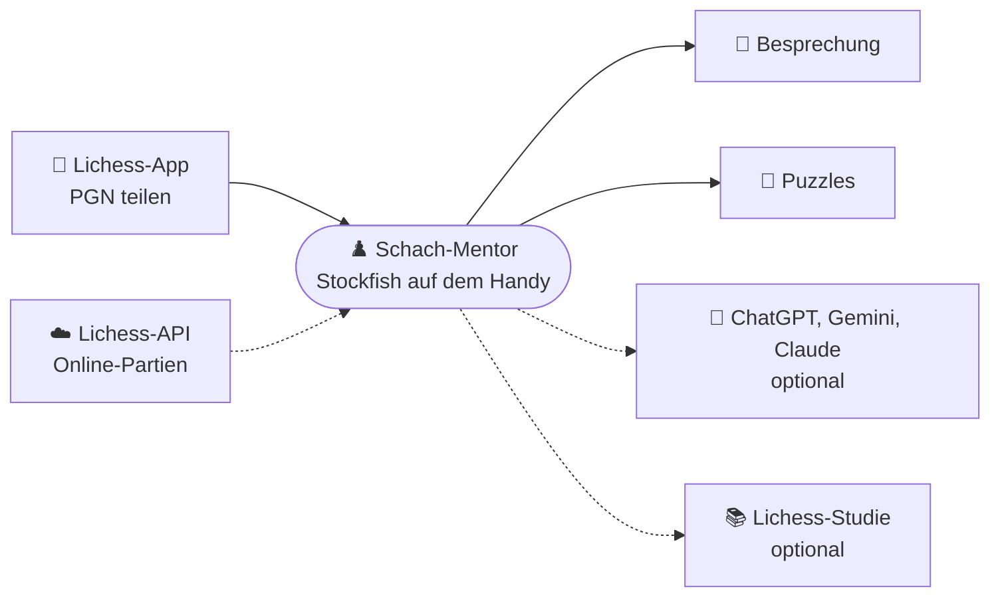
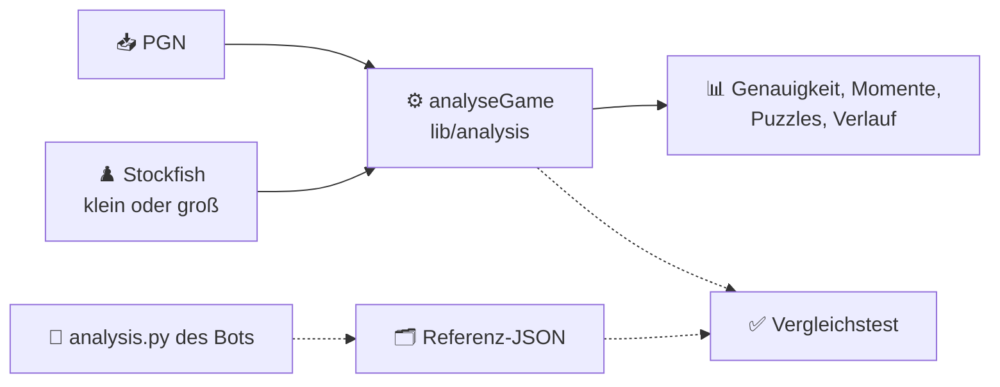

# ♟️ Schach-Mentor (Android-App)

Stockfish rechnet, du lernst: Android-App, die eigene Schachpartien auf dem Handy analysiert, Fehler im Dialog bespricht
und als Puzzles mit Wiederholung einübt. Ohne eigenen Server und ohne Pflicht-Schlüssel. Abgeleitet vom Telegram-Bot
[chess-mentor](https://github.com/adubdubdub/chess-mentor).

> **Stand: Phase 1.** Partien kommen per Teilen, Einfügen oder Datei in die App. Stockfish analysiert sie auf dem Handy
> wie der Telegram-Bot: Genauigkeit, Fehler-Einstufung, Verlauf und Schlüsselmomente mit Pfeilen und Varianten.
> Die sokratische Besprechung und die Puzzles folgen.

## 🧭 Zielbild



Texte entstehen in drei Stufen, nur die erste ist Pflicht:

| Stufe | Wie | Kosten |
|---|---|---|
| Textbausteine | aus Engine-Fakten und Motiven, offline | keine |
| Übergabe | fertiger Prompt per Teilen an eine Chat-App, Stockfish prüft dort nichts mehr | keine |
| Eigener Schlüssel | App fragt den Anbieter des Nutzers direkt | je nach Anbieter |

## 🗂️ Aufbau

```
chess-mentor-app/
├── lib/
│   ├── analysis/        Port von analysis.py: Gewinnchance, Einstufung, Momente, Motive (reines Dart, testbar)
│   ├── engine/          Stockfish auf dem Handy (kleines/großes Netz), Netz-Download, Analyse-Warteschlange
│   ├── data/            Partien in SQLite, Einstellungen
│   ├── ui/              Partienliste, Import, Partie- und Momentansicht, Engine-Seite, Texte DE/EN
│   └── main.dart
├── test/                Unit-Tests und Vergleich mit dem Bot (fixtures: gemeinfreie Partien + Bot-Referenz)
├── android/             Android-Projekt, Speichergrenzen in gradle.properties
├── tools/
│   ├── build-apk.sh     begrenzter APK-Build für den Heimserver
│   └── make_golden.sh   Referenzanalyse mit dem Code des Telegram-Bots erzeugen
└── LICENSE              GPL-3.0
```

## 🔬 Analyse wie der Bot



Der Vergleichstest rechnet dieselben Partien mit derselben Engine wie der Bot (Stockfish im Container `chess-mentor`)
und prüft jedes Feld. Ohne den Container wird er übersprungen.

| Netz | Herkunft | Pixel 6, Tiefe 16, 1 Thread |
|---|---|---|
| klein (`light`) | in der App, ~1 MB | 0,73 s je Stellung |
| groß (`nn-1a298aa575a0`) | Download 98,5 MB, SHA-256-Prüfung | wird gemessen |

## ⚙️ Entwicklung

```bash
flutter pub get
flutter analyze
flutter test
tools/build-apk.sh       # Release-APK: build/app/outputs/flutter-apk/app-release.apk
adb install -r -t build/app/outputs/flutter-apk/app-release.apk   # -t: APK ist derzeit test-only
```

Gebaut wird nur `arm64-v8a` (`android.injected.build.abi` in `android/gradle.properties`).

## ⚠️ Stolpersteine

- `multistockfish` kompiliert drei Engines aus C++. Ohne Grenze hat das den Heimserver lahmgelegt, deshalb dort nie
  `flutter build` direkt aufrufen. `tools/build-apk.sh` baut in einer eigenen cgroup, mit einem Compiler-Job und
  Wächter. Es setzt die Pfade dieses Servers voraus.
- Die Vorlage von Flutter setzt Gradle auf 8 GB Heap, hier sind es 2 GB.
- **Zum Testen immer Release bauen:** Im Debug-Build kompiliert das Stockfish-Plugin ohne Optimierung und rechnet um ein
  Vielfaches langsamer (ca. 25 s statt 0,7 s je Stellung).
- Mehr Threads machen die Analyse bei fester Tiefe nicht schneller (Pixel 6: 4 Threads 1,41 s, 1 Thread 0,73 s).
- Bei ausgeschaltetem Bildschirm pausiert Android die Engine; die App hält ihn während einer Analyse wach.
- Die APK ist noch als `testOnly` markiert und braucht `adb install -t`. Vor der Veröffentlichung entfernen.

## 🗺️ Roadmap

- [x] **Phase 0:** Werkzeuge, Prüf-App auf dem Gerät (getestet auf Pixel 6, Android 16)
- [x] **Phase 1:** PGN-Eingang, Analyse (Vergleich mit dem Bot, beide Netze)
- [ ] **Phase 2:** Besprechung am Brett
- [ ] **Phase 3:** Puzzles mit Wiederholung
- [ ] **Phase 4:** Lichess-Abruf und Studien-Export
- [ ] **Phase 5:** KI-Übergabe und eigener Schlüssel
- [ ] **Phase 6:** Veröffentlichung als APK, später F-Droid

## 📜 Lizenz

GPL-3.0, weil Stockfish und die Lichess-Pakete unter dieser Lizenz stehen. Die App steht in keiner Verbindung zu Lichess.
