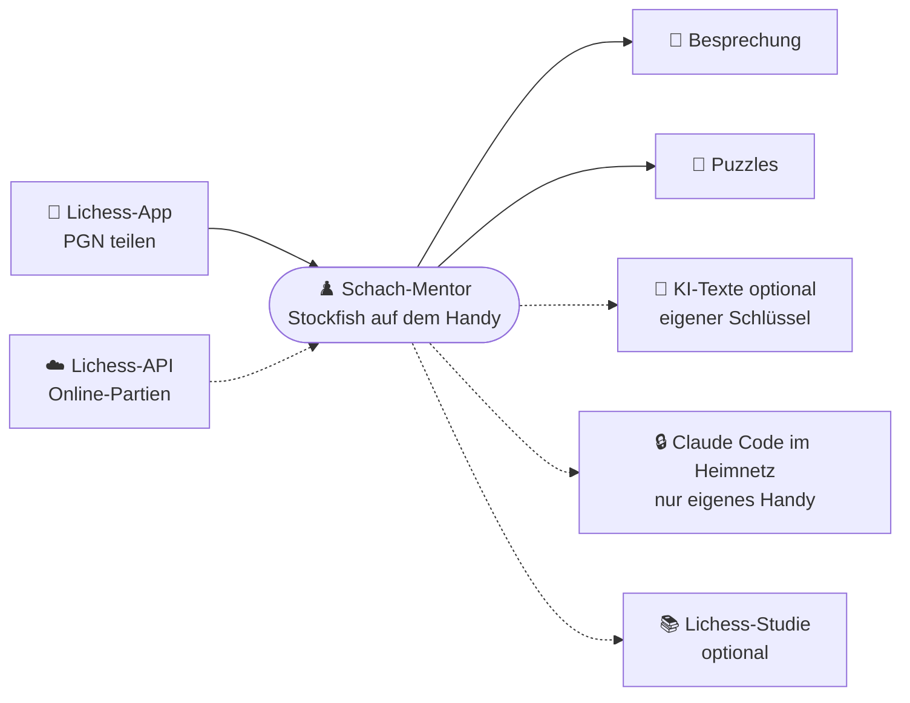
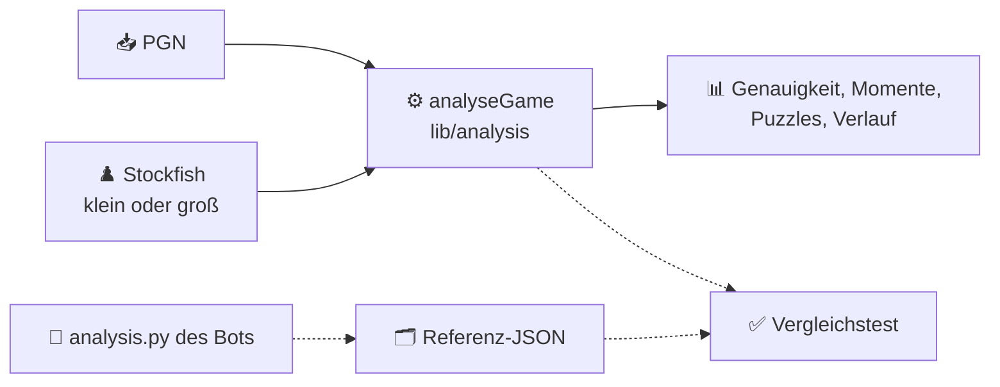
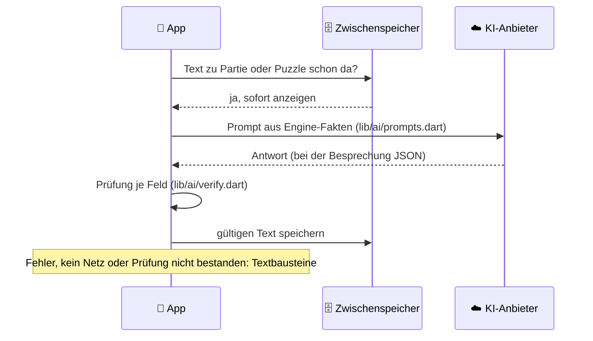
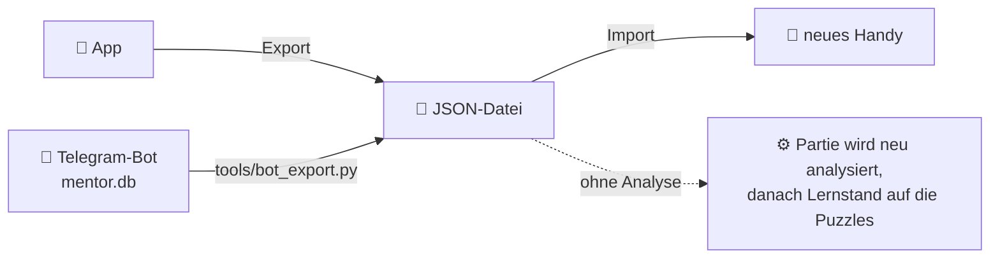
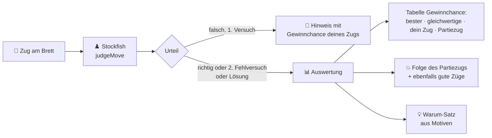

# ♟️ Schach-Mentor (Android-App)

Stockfish rechnet, du lernst: Android-App, die eigene Schachpartien auf dem Handy analysiert, Fehler im Dialog bespricht
und als Puzzles mit Wiederholung einübt. Ohne eigenen Server und ohne Pflicht-Schlüssel. Entstanden aus einem privaten
Telegram-Bot, den die App ab Ende 2026 ersetzt.

> **Stand: Schritt 3 von 8 (15.11.2026), nächster Schritt 4: Export/Import.** Partien kommen per Teilen, Einfügen oder Datei in die App. Stockfish analysiert sie auf dem Handy
> wie der Telegram-Bot: Genauigkeit, Fehler-Einstufung, Verlauf und Schlüsselmomente mit Pfeilen und Varianten.
> Dazu kommen die sokratische Besprechung am Brett und Puzzles aus eigenen Fehlern mit Wiederholung und Erinnerung.
> Texte kommen auf Wunsch von einer KI (eigener Heimserver oder eigener Schlüssel), immer gegen die Engine-Fakten geprüft.

## Auf einen Blick
| | |
|---|---|
| **Zweck** | Schach-Analyse und Lerntrainer als Android-App |
| **App-ID** | `io.github.adubdubdub.schachmentor` |
| **Engine** | Stockfish 17.1 auf dem Handy |
| **Build** | nur mit `tools/build-apk.sh`, CI bei jedem Push |
| **Nachfolger von** | Telegram-Bot `chess-mentor` |

> [!CAUTION]
> Der Release-Signierschlüssel (`/root/keys/schachmentor`) wird nie ausgegeben oder committet. Geht er verloren, gibt es keine Updates mehr.

## 🧭 Zielbild



Texte entstehen in drei Stufen, nur die erste ist Pflicht:

| Stufe | Wie | Kosten |
|---|---|---|
| Textbausteine | aus Engine-Fakten und Motiven, offline | keine |
| Heimserver | Claude Code auf dem eigenen Server über ein KI-Gateway (OpenAI-kompatibel), nur für das eigene Handy | eigenes Abo |
| Eigener Schlüssel | App fragt den Anbieter des Nutzers direkt (OpenAI-kompatibel: OpenRouter, Gemini, Ollama, OpenAI) | je nach Anbieter |

Jeder KI-Text wird gegen die Engine-Fakten geprüft. Nennt er einen Zug, der dort nicht steht, gelten die Textbausteine.
Mehr dazu im Abschnitt [KI-Texte](#-ki-texte).

## 🗂️ Aufbau

```
chess-mentor-app/
├── lib/
│   ├── analysis/        Port von analysis.py: Gewinnchance, Einstufung, Momente, Motive (reines Dart, testbar)
│   ├── coach/           Texte des Mentors ohne Sprachmodell: Fragen, Tipps, Erklärungen, Lernpunkt
│   ├── ai/              KI-Texte: Anbieter, Prompts, Prüfung gegen Engine-Fakten, Zwischenspeicher, Schlüssel (Keystore)
│   ├── puzzles/         Wiederholungsplan (Stufen, Wertung), Folgezug zweizügiger Puzzles, Erinnerungen
│   ├── engine/          Stockfish auf dem Handy (kleines/großes Netz), Netz-Download, Analyse-Warteschlange, Vordergrunddienst
│   ├── fetch/           Online-Partien von Lichess und Chess.com per Benutzername
│   ├── data/            Partien, Puzzles, Versuche und KI-Texte in SQLite, Einstellungen, Export/Import (backup.dart)
│   ├── ui/              Partienliste, Import, Partie- und Momentansicht, Gewinnchance-Tabelle, Engine-Seite, Texte DE/EN
│   └── main.dart
├── test/                Unit-Tests und Vergleich mit dem Bot (fixtures: gemeinfreie Partien + Bot-Referenz)
├── .github/workflows/   CI: Analyse, Tests, Prüf-Build (Flutter-Version festgelegt)
├── android/             Android-Projekt, Speichergrenzen in gradle.properties, Signierung (Schlüssel außerhalb des Repos)
├── tools/
│   ├── build-apk.sh     begrenzter APK-Build für den Heimserver
│   ├── bot_export.py    Daten des Telegram-Bots in eine Exportdatei umwandeln (einmalig)
└── LICENSE              GPL-3.0
```

## 🔬 Analyse wie der Bot



Der Vergleichstest rechnet dieselben Partien mit derselben Engine wie der Bot (Stockfish 17.1, lokales Binary über
`STOCKFISH_BIN`) und prüft jedes Feld gegen die gespeicherten Referenzanalysen des Bots (`test/fixtures/*.golden.json`).
Der Bot ist eingestellt, die Referenzen bleiben als feste Vergleichswerte. Ohne Stockfish wird der Test übersprungen.

| Netz | Herkunft | Pixel 6, Tiefe 16, 1 Thread |
|---|---|---|
| klein (`light`) | in der App, ~1 MB | 0,73 s je Stellung |
| groß (`nn-1a298aa575a0`) | Download 98,5 MB, SHA-256-Prüfung | 1,26 s je Stellung |

## 🤖 KI-Texte

Die Analyse läuft immer auf dem Handy. Die KI formuliert nur Texte aus den Engine-Fakten: Erklärung zum Puzzle sowie
Frage, Tipp, Erklärung, Zusammenfassung und Lernpunkt der Besprechung. Es gibt **einen** Anbietertyp,
OpenAI-kompatibel (Basis-URL, Modell, Schlüssel, optional Kopfzeilen für Cloudflare Access). Damit funktionieren das
eigene KI-Gateway, OpenRouter, Gemini, Ollama und OpenAI gleich. Einstellung: Einstellungen → KI-Texte, mit
Verbindungstest.



Prüfung je Feld, jeweils mit Rückfall auf den Textbaustein nur für dieses Feld:
- Jeder genannte Zug (nummeriert, mit Figurenbuchstabe oder Schlagzug) muss in den Fakten stehen.
- Frage und Tipp dürfen den besten Zug nicht nennen, auch nicht sein Zielfeld.
- Leere oder nicht lesbare Antworten werden verworfen.

Texte, die eine KI geschrieben hat, tragen das Zeichen „✨ KI“ (Antippen erklärt, was geprüft wird). Gesendet werden nur Stellungen, Züge und Bewertungen aus der Analyse, keine Spielernamen und keine Kontodaten. Ein Text wird einmal erzeugt und gespeichert (Schlüssel enthält Art, Id, Sprache und Prompt-Version). Zugangsdaten liegen im
Android-Keystore (`flutter_secure_storage`), nicht in den Einstellungen und nicht im Backup (`allowBackup` aus).
**Heimserver ist nur für das eigene Handy gedacht**, weil das Abo persönlich ist; andere Nutzer verwenden Textbausteine
oder einen eigenen Schlüssel.

## 🌐 Online-Partien

Einstellungen → „Online-Konten“: Benutzername für **Lichess** und **Chess.com** eintragen, kein Schlüssel nötig. Die App
holt neue, beendete Standard-Partien über die öffentlichen Schnittstellen (`lib/fetch/`), legt sie an und analysiert sie
automatisch. Die Farbe ergibt sich aus dem Benutzernamen.

| | Lichess | Chess.com |
|---|---|---|
| Schnittstelle | `/api/games/user/<name>` (PGN) | `/pub/player/<name>/games/archives`, dann Monatsarchive |
| Filter | nur Standard-Zeitkontrollen, keine Varianten | nur `rules = chess` |
| „Seit“ | Startzeit der zuletzt geholten Partie | Endzeit der zuletzt geholten Partie |

- Erster Abruf: letzte 7 Tage, danach nur neue, höchstens 30 je Abruf. Beim Start höchstens einmal in 20 Stunden
  (abschaltbar), außerdem „Jetzt abrufen“ und das Wolken-Symbol in der Partieliste.
- Beide Dienste verlangen eine eigene Kennung im `User-Agent` (ohne sie antwortet Lichess mit 404).
- Eine Datei oder ein Text mit **mehreren Partien** (Lichess-Export, Sammel-PGN) wird beim Import in einzelne Partien
  zerlegt; wo die Farbe nicht klar ist, wählst du sie in der Partie.
- Die Benutzernamen gehören zum Export (kein Passwort) und werden beim Import nur eingetragen, wenn noch keiner steht.

## 🔋 Analyse im Hintergrund

Mit „Analyse im Hintergrund“ (Standard: an) läuft während einer Analyse ein Android-Vordergrunddienst
(`lib/engine/background.dart`, `flutter_foreground_task`, Typ `dataSync`). Er hält den Prozess und einen Wake-Lock und
zeigt den Fortschritt („Partie 2 von 7 · 35 %“) als Benachrichtigung; die Analyse selbst läuft weiter in der App.
Ausgeschaltet bleibt der Bildschirm während der Analyse an. Android 13 und neuer braucht die Erlaubnis für
Benachrichtigungen, sonst läuft der Dienst ohne sichtbare Anzeige.

## 💾 Export und Import

Einstellungen → „Daten sichern und übernehmen“: alle Partien samt Lernstand als eine JSON-Datei (`schach-mentor-export`,
Version 1; `lib/data/backup.dart`). Wegen des ausgeschalteten Android-Backups ist das der Weg auf ein neues Handy.
Auch eine geteilte oder geöffnete Exportdatei wird erkannt.



| Inhalt je Partie | Bemerkung |
|---|---|
| PGN, Farbe, Datum | Schon vorhandene Partien (gleiche Zugfolge) bleiben unverändert |
| Analyse | optional; ohne sie rechnet die App neu |
| Puzzle-Lernstand | Stufe, Fälligkeit, Wiederholungen, Versuche, gespeicherte KI-Texte; Zuordnung über die Zugnummer (`ply`) |
| KI-Texte der Besprechung | Texte ohne Versionsangabe gelten für die aktuelle Prompt-Version |

Nicht enthalten: Schlüssel, Zugangsdaten und Einstellungen. Die Datei ist unverschlüsselt. `tools/bot_export.py` wandelt die
Datenbank des Telegram-Bots einmalig um (nur lesend).

## 🧩 Puzzle-Wertung

Jeder Versuch wird gespeichert (Tabelle `puzzle_attempts`: Ausgang, falsche Züge, Tipp ja/nein).

| Ausgang | Bedingung | Folge |
|---|---|---|
| Erster Versuch | bester oder gleichwertiger Zug (unter 5 Punkten schwächer), ohne Tipp | steigt eine Stufe auf (1 · 3 · 7 · 21 · 60 Tage) |
| Zweiter Versuch | mit Tipp oder im zweiten Anlauf gelöst | bleibt auf der Stufe |
| Lösung gezeigt | Lösung angefordert oder zweimal falsch | zurück auf morgen |

Auch eine gute Alternative zählt als gelöst; die empfohlene Variante wird danach trotzdem gezeigt. **Zweizügige
Puzzles:** Nach dem ersten richtigen Zug antwortet der Gegner, und der nächste eigene Zug wird gefragt, aber nur wenn er
eindeutig ist (mindestens 15 Prozentpunkte besser als der zweitbeste, Prüfung beim Lösen mit Stockfish,
`lib/puzzles/follow_up.dart`).

## 🧩 Puzzle-Auswertung

Nach jedem Puzzle (gelöst oder Lösung gezeigt) erklärt die App, **warum** ein Zug gut oder schlecht war. Alle Zahlen
kommen von Stockfish, die Sätze aus Textbausteinen (`coach_texts.dart`), also ohne Sprachmodell und offline.



Die Gewinnchance-Tabelle (`lib/ui/evaluation_table.dart`) ist ein gemeinsames Bauteil: Puzzle, Besprechung und Partieansicht zeigen dieselbe Tabelle (bester Zug zuerst, Rest nach Gewinnchance sortiert, Differenz aus gerundeten Werten, Züge mit Zugnummer). Die Prozentwerte stehen nur dort, nicht noch einmal im Fließtext. Das Muster stammt vom Telegram-Bot, dort ergänzt Claude die Erklärung. Abstimmung der beiden Projekte:
Brain-Notiz „Schach-Mentor – Bot und App abgleichen“.

## ⚙️ Entwicklung

```bash
flutter pub get
flutter analyze
flutter test --exclude-tags engine   # schnelle Tests, laufen auch in der CI
STOCKFISH_BIN=/pfad/zu/stockfish flutter test --tags engine   # Vergleich mit dem Bot, braucht Stockfish 17.1
tools/build-apk.sh       # Release-APK: build/app/outputs/flutter-apk/app-release.apk
adb install -r build/app/outputs/flutter-apk/app-release.apk
```

- Gebaut wird nur `arm64-v8a` (`abiFilters` und `packaging` in `android/app/build.gradle.kts`).
- **Signierung:** Die Release-APK wird mit einem Schlüssel außerhalb des Repos signiert (Pfad über
  `SCHACHMENTOR_KEY_PROPERTIES` oder Standardpfad, siehe `build.gradle.kts`); ohne Schlüssel gilt der Debug-Schlüssel.
  Schlüsseldateien stehen in `.gitignore`. **Verlust des Schlüssels bedeutet keine Updates mehr.**
- **CI** (`.github/workflows/ci.yml`): Analyse und Tests bei jedem Push, dazu ein unsignierter Prüf-Build. Die
  Flutter-Version ist festgelegt, weil neuere Versionen `package:flutter/material.dart` als veraltet melden.
- Die Engine-Tests brauchen ein lokales Stockfish (`STOCKFISH_BIN`), sie laufen nur auf dem Heimserver.

## ⚠️ Stolpersteine

- `multistockfish` kompiliert drei Engines aus C++. Ohne Grenze hat das den Heimserver lahmgelegt, deshalb dort nie
  `flutter build` direkt aufrufen. `tools/build-apk.sh` baut in einer eigenen cgroup, mit einem Compiler-Job und
  Wächter. Es setzt die Pfade dieses Servers voraus.
- Die Vorlage von Flutter setzt Gradle auf 8 GB Heap, hier sind es 2 GB.
- **Zum Testen immer Release bauen:** Im Debug-Build kompiliert das Stockfish-Plugin ohne Optimierung und rechnet um ein
  Vielfaches langsamer (ca. 25 s statt 0,7 s je Stellung).
- Mehr Threads machen die Analyse bei fester Tiefe nicht schneller (Pixel 6, kleines Netz: 4 Threads 1,28 s, 1 Thread
  0,73 s; großes Netz: 3,35 s gegenüber 1,26 s).
- Bei ausgeschaltetem Bildschirm pausiert Android die Engine; deshalb gibt es den Vordergrunddienst (siehe Analyse im Hintergrund) oder, ausgeschaltet, einen wachgehaltenen Bildschirm. Ob der Dienst die Engine auf allen Geräten zuverlässig am Laufen hält, ist noch am Handy zu prüfen.
- Die App-ID `io.github.adubdubdub.schachmentor` ist nach der ersten Weitergabe nicht mehr änderbar.
- KI-Antworten sind nicht deterministisch: Ein Text kann bei einem Aufruf die Prüfung bestehen und beim nächsten nicht. Darum zählt immer der Rückfall.

## 🗺️ Roadmap

- [x] **Phase 0:** Werkzeuge, Prüf-App auf dem Gerät (getestet auf Pixel 6, Android 16)
- [x] **Phase 1:** PGN-Eingang, Analyse (Vergleich mit dem Bot, beide Netze)
- [x] **Phase 2:** Besprechung am Brett (Frage, Zug, Prüfung, Tipp, Auflösung, Lernpunkt)
- [x] **Phase 3:** Puzzles mit Wiederholung (1 · 3 · 7 · 21 · 60 Tage), tägliche Erinnerung ohne Server, Auswertung mit Gewinnchance, Folge und Begründung
- [x] **Schritt 1:** Aufräumen: App-ID `io.github.adubdubdub.schachmentor`, Signierschlüssel, kein `testOnly`, GitHub Actions
- [x] **Schritt 2:** Puzzles: Versuche speichern ✅, Aufstieg nur im ersten Versuch ohne Tipp ✅, zweizügige Puzzles ✅ (Folgezug wird beim Lösen auf Eindeutigkeit geprüft, Abstand ≥ 15 Prozentpunkte)
- [ ] **Schritt 3:** KI-Texte: Heimserver (Claude Code über das KI-Gateway) und eigener Schlüssel, mit Zugprüfung (Puzzle und Besprechung; offen: Test auf dem Handy, optional Anthropic direkt)
- [ ] **Schritt 4:** Export/Import und Übernahme der Bot-Daten (umgesetzt und per Unit-Tests geprüft; offen: Test auf dem Handy mit den echten Bot-Daten)
- [ ] **Schritt 5:** Abruf per Benutzername (Lichess, Chess.com), mehrere Partien je PGN (umgesetzt und per Unit-Tests und Live-Abruf geprüft; offen: Test auf dem Handy)
- [ ] **Schritt 6:** Mentor-Kern: Schwächenprofil über die letzten 20 Partien (Themen aus Motiven, Phase, „Vorteil verspielt“, Eröffnung, Puzzle-Stand) und Wochenfokus mit Vorschlag und Wahl, Puzzles zum Fokusthema zuerst; Etappen 6a Themen und Tests (umgesetzt: `lib/mentor/`), 6b Profilseite (umgesetzt: Symbol „Mentor“ in der Partieliste), 6c Wochenfokus (umgesetzt mit automatischer Auswertung), 6d KI-Text und Benachrichtigung (umgesetzt), 6e Wochenrückblick (umgesetzt)
- [ ] **Schritt 7:** Erste Weitergabe an Familie und Freunde (GitHub Releases, Obtainium)
- [ ] **Schritt 8:** F-Droid: Übersetzungsdateien, Barrierefreiheit, Datenschutzhinweis

iOS ist zurückgestellt.

## 📜 Lizenz

GPL-3.0, weil Stockfish und die Lichess-Pakete unter dieser Lizenz stehen. Die App steht in keiner Verbindung zu Lichess.
